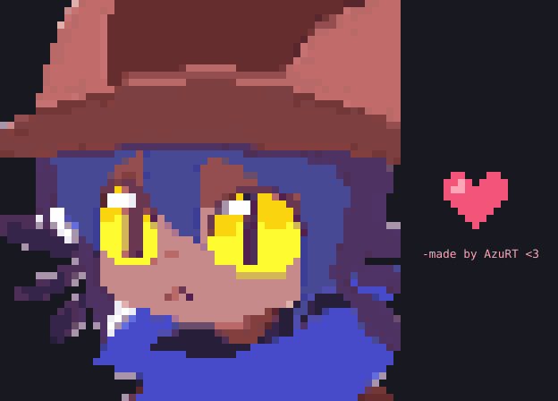

# Niko Terminal

Niko de **OneShot** en pixel art couleur dans le terminal, avec redimensionnement automatique.



Créé pour AzuRT. Le portrait reprend une référence fournie par l’utilisateur : 56 × 56 pixels, 32 couleurs et fond extérieur transparent.

## Fonctionnement

- Un petit cœur rose en pixels et la signature `-made by AzuRT <3` accompagnent Niko à droite (ou en dessous dans une fenêtre étroite).
- Le portrait tient compte de la largeur **et** de la hauteur du terminal.
- Le dessin conserve ses proportions lorsque la fenêtre rétrécit ou s’agrandit.
- Fish redessine le portrait dans l’invite en conservant le texte en cours de saisie.
- L’invite transitoire retire le portrait précédent à l’exécution d’une commande, pour garder un historique lisible.

## Prérequis

Linux ou macOS, Python 3, Fish **4.1 ou plus récent**, et un terminal compatible ANSI 24 bits et Unicode. Testé avec Fish 4.9.3 sous Linux.

## Installation

```sh
git clone https://github.com/guestop89/niko-terminal.git
cd niko-terminal
python3 install.py
```

Ouvre ensuite un nouveau terminal Fish. L’installation se fait uniquement dans ton compte utilisateur, sans `sudo`. Le fichier `config.fish` existant est sauvegardé avant toute modification. Relancer l’installation met à jour le même bloc.

## Affichage ponctuel

```sh
python3 niko.py
python3 niko.py --clear
```

L’affichage ponctuel adapte la taille au lancement. Le redimensionnement en direct nécessite l’intégration Fish installée par `install.py`.

## Vérification

```sh
python3 -m unittest discover -s tests
fish -n niko.fish
```

## Désinstallation

Retire le bloc compris entre `# >>> Niko Terminal >>>` et `# <<< Niko Terminal <<<` dans `~/.config/fish/config.fish`, puis supprime `~/.local/bin/niko-banner` et `~/.config/niko-terminal`. Ouvre un nouveau terminal. Une sauvegarde de l’ancienne configuration est disponible à côté de `config.fish`.

## Crédits

Niko et OneShot appartiennent à leurs créateurs et ayants droit respectifs. Projet de fan non officiel ; aucun droit sur le personnage ou l’illustration d’origine n’est revendiqué.
